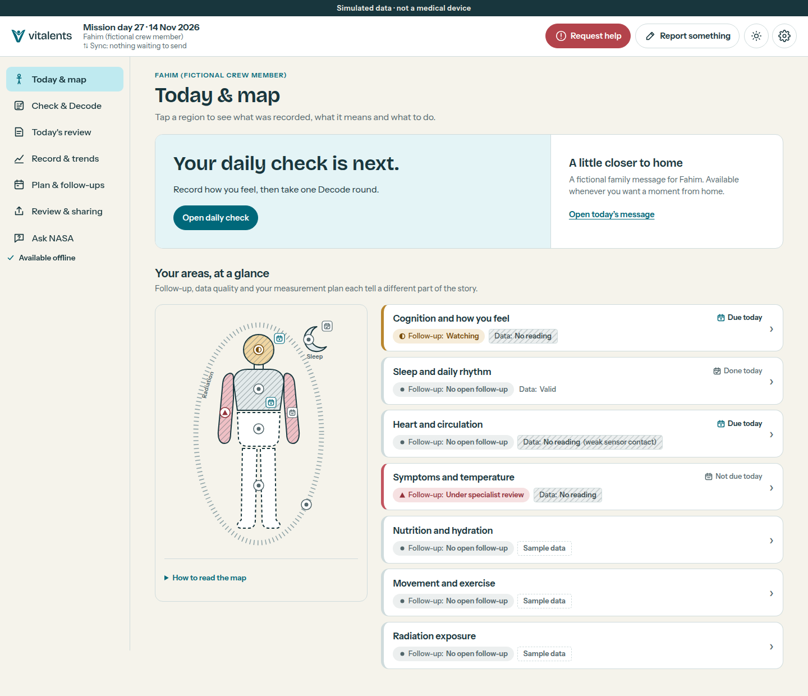

<div align="center">
  <picture>
    <source media="(prefers-color-scheme: dark)" srcset="app/public/brand/lockup-dark.svg">
    
  </picture>
  <p><strong>Health follow-up the astronaut understands and acts on.</strong></p>
  <p>A space-health prototype connecting daily observations, personal context and the next human decision.</p>
  <p>
    <a href="https://vitalents.life/">Explore the demo</a> ·
    <a href="docs/demo-guide.md">Three-minute tour</a> ·
    <a href="docs/README.md">Documentation</a> ·
    <a href="docs/validation.md">Evidence & limits</a>
  </p>
</div>

[](https://vitalents.life/)

*The S1 simulated scenario, captured from the production build.*

## A record that leads to a next step

Fahim, a fictional crew member, feels alert. His recent Decode results have fallen below his personal range, his nights have been short, and a symptom still needs follow-up. Vitalents puts these observations together while keeping their meanings separate: what was recorded, what changed, what is missing, and who decides what happens next.

**Collect → review → understand → act → follow up.**

The demonstration includes five simulated scenarios, a playable 90-second Decode task, a body map, personal trends, follow-up actions and a simulated delayed link to the medical team and mission planner.

| Explore | What to look for |
|---|---|
| **Today & map** | Information quality and follow-up status stay separate; a missing reading is visible. |
| **Check & Decode** | Self-report beside task performance, with no combined readiness score. A fictional message from home is available independently of performance. |
| **Today's review** | Observations, a next step and “Why?” links to the records and rules behind it. |
| **Plan & follow-ups** | Named decision owners, schedule options and explicit later review. Completing a step does not establish recovery. |
| **Review & sharing** | A preview of the shared summary, private-note exclusion and distinct delivery states. |
| **Ask NASA & Proof** | A source-linked library, recorded assistant responses, reproducible checks and their limits. |

Start with the [three-minute tour](docs/demo-guide.md), then try the missing-data, fixed-schedule, symptom and communication-delay scenarios in **Settings**.

## Run locally

Use **Node.js 22 or newer** and npm. From a clone of this repository:

```bash
cd app
npm ci
npm run dev
```

Open the local URL printed by Vite. No model service or API key is needed for the default demo. The app uses recorded assistant responses; the core journey runs independently of the assistant.

See the [app guide](app/README.md) for builds, browser tests, offline use and optional local AI.

## Inside the repository

| Directory | Purpose |
|---|---|
| [app/](app/) | React and TypeScript application, browser storage, UI and engine tests |
| [contracts/](contracts/) | JSON Schemas, examples and shared test vectors |
| [science/](science/) | Simulation, reference calculations and data validation |
| [research/](research/) | Separate exploratory models on synthetic examples |
| [ai/](ai/) | Optional local assistant, source corpus and recorded-answer review policy |
| [content/](content/) | Domain descriptions, source excerpts and demonstration rules |
| [scripts/](scripts/) | Data generation, publication and consistency checks |
| [docs/](docs/README.md) | Demo guide, architecture, contracts and evidence |

Read the [architecture guide](docs/architecture.md) for how these pieces connect. Application checks run with `npm test` and `npm run build` from `app/`; the [CI workflow](.github/workflows/ci.yml) also checks browser journeys, Python logic, data contracts, source handling and wording.

## Scope and evidence

**This is a prototype with simulated histories, not a medical device.** A live Decode round is labelled separately when added to the simulated record. Decode, personal-reference policies and demonstration thresholds need independent validation; software tests and synthetic research results do not establish clinical performance.

Role switching and delayed sharing are local browser demonstrations, not authenticated medical accounts or real space communication. Offline use requires an initial online load of the production build. The public Cloudflare build uses recorded assistant responses under an explicit publication policy; two unsupported explanations are withheld. Source content remains draft pending human review, and source-specific rights limits are documented.

The [evidence and limitations](docs/validation.md) describe these boundaries and the checks behind the prototype. See [sources and credits](docs/credits.md) for scientific references and AI/media disclosure. NASA and ESA references provide background; this project does not claim endorsement or official competition acceptance.
