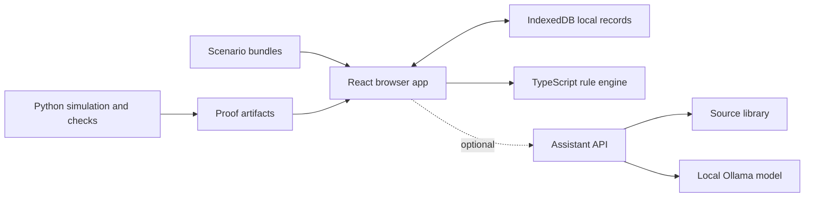

# Vitalents · Software requirements specification

## 0. How to use this document

This specification preserves the original requirement IDs for traceability. It describes intended behavior, including requirements that may remain unimplemented; it is not a test report or evidence of clinical validity. The current [data contract](CONTRACT_P0.md) overrides earlier enum names, record shapes, scenario numbering and reference policy here. See [architecture](architecture.md) for the implemented components and [validation](validation.md) for evidence and limits.

| Prefix | Meaning |
|---|---|
| `FR-xx-nn` | Functional requirement, grouped by module |
| `NFR-nn` | Non-functional requirement |
| `DR-nn` | Data requirement |

**Priority:** M = must; S = should; C = could. Priorities are design intent, not completion status. Numeric thresholds are demonstration parameters unless a separately cited source establishes otherwise.

## 1. Introduction

### 1.1 Purpose

Vitalents brings an astronaut’s physical indicators, cognitive performance and self-assessment together in a body map and a personal record. It helps the astronaut understand a change and its context, choose a suitable step, then follow up and share with a specialist when needed. This SRS defines the **demonstration prototype** for NASA Space Apps 2026, challenge “Create Health Monitoring Software for Astronauts on Space Missions”.

### 1.2 Product scope of the MVP

The MVP shows the **complete loop on simulated data**: collect → review → understand → act → follow → review the plan. It covers eleven modules (M1–M11) at the depth defined in the scope document’s MVP boundary, repeated in section 2.4.

### 1.3 What the product must never do

These are system-wide constraints. Any code, text or model output that breaks them is a defect.

- Never diagnose, never name a medication or a dose, never produce a readiness percentage or a “ready / not ready” verdict.
- Never show “healthy”. The absence of an open follow-up is shown as **“No open follow-up”**; the absence of data as **“No reading”**.
- Never subtract the self-rating from the Decode result, or present any single “gap score”.
- Never claim a cause from two observations that happen together, or that an action “worked”.
- Never change a medical limit or a reference silently or automatically from feedback.
- Never let core functions depend on the language model.

### 1.4 Definitions

| Term | Meaning in this SRS |
|---|---|
| **Observation (record)** | One measurement, self-report or estimate, with its provenance (DR-01) |
| **Session** | One Decode run with its context and quality data (DR-02) |
| **Reference** | The astronaut’s own comparison range for one indicator, versioned (DR-03) |
| **Finding** | A specific, traceable statement produced by a rule, e.g. “3 sessions below your reference” (DR-04) |
| **Information status** | Is the data usable? `no_reading` · `incomplete` · `not_comparable` · `valid` |
| **Follow-up status** | Does it need attention? `none` · `watching` · `action_open` · `review_requested` · `specialist_review` · `closed` |
| **Step** | The action proposed by a rule, with reason, source and decision owner |
| **Follow-up** | A thread that holds actions, results and the decision to close or continue (DR-08) |
| **Rest opportunity** | Rest time made available by a schedule change; not a promise of sleep |
| **Simulated** | Any record created by the simulator; always flagged and labelled |

### 1.5 References

[1] NASA Standard Measures · [2] NASA Risk from Inadequate Sleep and Irregular Schedules · [3] University of Pennsylvania Cognition test battery · [4] Basner et al. 2020, practice effects · [5] NASA Medical Operations · [6] NASA Medical Decision Support (concept) · [7] PhysioNet QoL_Stress v1.0.0 · [8] NASA Life Sciences Data Archive · [9] ESA Radiation and magnetic fields · [10] NASA OSDR controlled-access data.

## 2. Overall description

### 2.1 Users and roles

| Role | Goal | Access summary (full matrix in section 9) |
|---|---|---|
| **Astronaut** | Daily follow-up, understanding, acting, sharing on their terms | Their full record |
| **Medical** (crew medical officer and ground team) | Review, request measurements, approve or change plans | What the astronaut shared: sequence, relevant measurements and limits, symptoms, actions tried, question |
| **Planner** (mission planner) | Handle operational requests | Declared operational needs only |

In the MVP, roles are switched with a **role switcher** in settings (no authentication). The switcher exists to demonstrate permissions.

### 2.2 Operating environment

- **Demo laptop** (32 GB unified memory): the web app served locally, the assistant service on `localhost:8008` with Ollama. Must work with the network **off**.
- **Public link** (Cloudflare Pages at **vitalents.life**): the same app in **cached mode**: the assistant shows recorded answers labelled as such. Branch builds may have preview deployments.
- Modern Chromium-based browser; screen widths from 390 px (phone) to 1440 px.

### 2.3 Constraints

- English only in the product and in everything submitted.
- No NASA logos or mission insignia.
- AI use must be described in the submission, including the in-product language model.
- Every number and every step shown to the user must carry its source.

### 2.4 MVP boundary

| Module | MVP depth | Not in MVP |
|---|---|---|
| M1 Shell, navigation, roles | Six entries, role switcher, read-only profile, “Report something”, “Request help”, simulated-data banner, day selector | Authentication |
| M2 Body map | 7 domains; sleep, cognition, heart, symptoms and temperature live; nutrition, movement, radiation as sample cards | Device integration |
| M3 Check and Decode | Daily check; Decode with full quality data; 30 s demo mode | PVT |
| M4 Reference, review | Reference engine and screen; Today’s review; four step categories | Approved medical limit sets |
| M5 Follow-ups, schedule | Action lifecycle; schedule-alternative calculator | Live timeline integration |
| M6 Library, assistant | 15–25 sources; local RAG; gap log; cached mode | Library update workflow |
| M7 Feedback loops | Reference screen, tried-actions log with rating, alert ratings → rule-review queue, gap log; preferences and one pattern if time | Research track (C only) |
| M8 Sharing, privacy | Consult summary, share preview, medical and planner views | Policy editor |
| M9 Offline, sync | Local-first store; simulated link with delay and five states | Real ground sync |
| M10 Simulation, validation | Crew of four; scenarios S1–S5; validation scripts | Validation studies |
| M11 Mission phases | During flight, from a seeded baseline | Pre- and post-flight flows |

## 3. Architecture

### 3.1 Components

**Implemented contract:** the browser engine and `science/contract_logic.py` reproduce the D-10 reference policy and shared vectors. The separate research estimator in `science/reference.py` has different eligibility and lifecycle semantics; it is not interchangeable with the app policy. See [integration notes](reference/INTEGRATION_NOTES.md).

### 3.2 Technology

| Layer | Choice |
|---|---|
| App | Vite, React 19, TypeScript, React Router, Zustand, Dexie (IndexedDB), Recharts, CSS variables for brand tokens |
| Engine | Plain TypeScript, no UI imports, Vitest tests |
| Science | Python 3.11, NumPy, pandas, SciPy, scikit-learn, pytest |
| Assistant | FastAPI, LangChain, Ollama; gpt-oss:20b (live), Qwen 27B (summaries, second candidate), nomic-embed-text (search) |
| Hosting | Cloudflare Pages (static app, cached assistant mode), custom domain `vitalents.life`, preview deployment per branch |

### 3.3 Repository layout

See the [repository map](../README.md) and [architecture](architecture.md). Application code, simulation, source material and contract fixtures have separate directories. Generated records retain their source and origin labels.

### 3.4 Configuration

| Variable | Values | Effect |
|---|---|---|
| `VITE_ASSISTANT_MODE` | `live` · `cached` · `auto` | Cached reads reviewed recordings; live calls the configured API; auto probes API health before falling back. Cloudflare builds force cached mode. |
| `VITE_ASSISTANT_URL` | URL | Explicit API endpoint; local live mode defaults to `http://localhost:8008`, auto to the configured public tunnel. |

### 3.5 Deployment (Cloudflare Pages)

| Setting | Value |
|---|---|
| Project | Cloudflare Pages, connected to the GitHub repository |
| Production branch | `main` → **vitalents.life** (and `www.vitalents.life` redirected to it) |
| Preview | Every branch and pull request gets its own `*.pages.dev` URL |
| Root directory | `app` |
| Build command | `npm ci && npm run build` |
| Output directory | `dist` |
| Environment variables | `VITE_ASSISTANT_MODE=cached`, `NODE_VERSION=22` |
| SPA routing | `app/public/_redirects` containing `/* /index.html 200` |
| Headers | `app/public/_headers`: a Content-Security-Policy allowing only same-origin scripts, `X-Content-Type-Options: nosniff`, `Referrer-Policy: no-referrer` |
| Analytics | Off (no tracking, NFR-09) |
| Manual fallback | `npx wrangler pages deploy app/dist --project-name vitalents` |

**Domain.** The public demo is linked from the repository README. A successful build alone does not verify the deployed revision.

**Assistant deployment.** Public Cloudflare builds use reviewed cached answers. Local live/auto mode may use the separately running assistant API. Only that API may be exposed through the optional tunnel; Ollama remains private. See [assistant setup](../ai/README.md).

## 4. Data requirements

All timestamps are ISO 8601 with time zone. All IDs are strings (UUID or readable IDs for seed data). Every entity created by the simulator has `simulated: true`.

### 4.1 Entities

**DR-01 Observation**

| Field | Type | Notes |
|---|---|---|
| `id`, `crew_id` | string | |
| `domain` | enum | `heart` · `sleep` · `cognition` · `symptoms` · `nutrition` · `movement` · `radiation` |
| `indicator` | string | e.g. `sleep_duration`, `pulse`, `temperature`, `alertness_self`, `mood`, `symptom` |
| `kind` | enum | `measurement` · `self_report` · `estimate` |
| `value`, `unit` | number or string; string | Unit required for numbers |
| `measured_at`, `recorded_at`, `received_at` | timestamp | `received_at` null until synced |
| `source` | object | `{type: device·astronaut·sim·lab, name, version}` |
| `conditions` | object | Free key–value, e.g. `{position: "seated", after_exercise: false}` |
| `info_status` | enum | Information status |
| `quality_reasons` | string[] | Why not `valid` |
| `correction` | object or null | `{of_id, reason}`; the original is never deleted |
| `edits` | array | `{at, field, from, to}` history |
| `simulated` | boolean | |

**DR-02 DecodeSession**

| Field | Type | Notes |
|---|---|---|
| `id`, `crew_id`, `task_version` | string | `task_version` = `decode-1.0` |
| `mode` | enum | `measure` · `demo` (demo never enters a reference) |
| `session_index` | integer | 1-based count of measure sessions for this crew member |
| `device` | object | `{class: laptop·tablet·phone, user_agent, screen}` |
| `started_at`, `ended_at` | timestamp | |
| `key` | object | Symbol id → digit, for this session |
| `items` | array | `{i, symbol, shown_ms, response, correct, rt_ms}` |
| `interruptions` | array | `{at_ms, duration_ms, type: hidden·pause}` |
| `outputs` | object | `{correct, attempted, accuracy, rt_median_ms, rt_iqr_ms, first30_correct, last30_correct}` |
| `validity` | object | `{comparable: boolean, reasons: string[]}` |
| `self_rating`, `mood` | integer | Collected in the check before the session |
| `simulated` | boolean | |

**DR-03 Reference**

| Field | Type | Notes |
|---|---|---|
| `id`, `crew_id`, `indicator` | string | |
| `version` | integer | Increments on every change |
| `status` | enum | `insufficient` · `active` · `frozen` |
| `method` | string | e.g. `robust-median-v1` |
| `data_ids` | string[] | Sessions or observations used |
| `period` | object | `{from, to}` |
| `center`, `spread`, `band` | number, number, [lo, hi] | |
| `limits_text` | string | Plain-language limits shown on the reference screen |
| `change_log` | array | `{version, at, reason, from_band, to_band}` |

**DR-04 Finding**: `id`, `crew_id`, `date`, `indicator`, `type` (`change_from_reference` · `missing` · `not_comparable` · `symptom` · `pattern` · `insufficient_reference`), `text`, `data_ids[]`, `rule_id`, `limits_text`.

**DR-05 Rule**: see section 6.

**DR-06 DailyReview**: `id`, `crew_id`, `date`, `recorded[]` (observation and session IDs), `changed[]` (finding IDs), `missing[]` (indicator IDs due but absent), `main_step` (action ID), `other_open_followups[]`.

**DR-07 Action**

| Field | Type | Notes |
|---|---|---|
| `id`, `crew_id`, `followup_id`, `rule_id` | string | |
| `category` | enum | `MEASUREMENT_ISSUE` · `INSUFFICIENT_REFERENCE` · `PLAN_NEED` · `REVIEW_REQUEST` |
| `title`, `reason` | string | |
| `source` | object | `{type: nasa·research·team_rule, title, url}` |
| `decision_owner` | enum | `astronaut` · `medical` · `planner` |
| `status` | enum | `proposed` · `accepted` · `declined` · `done` · `not_done` |
| `decline_reason` | string or null | Optional, logged |
| `followup_date` | date | |
| `result` | object or null | `{recorded_at, text, data_ids}` |
| `rating` | enum or null | `useful` · `not_useful` (astronaut feedback) |

**DR-08 FollowUp**: `id`, `crew_id`, `domain`, `indicator`, `status` (follow-up status), `opened_at`, `opened_by`, `action_ids[]`, `timeline[]` (`{at, event, by, ref}`), `closed_at`, `close_reason`.

**DR-09 ScheduleItem**: `id`, `title`, `start`, `end`, `fixed` (bool), `prep_minutes`, `movable_range` (`{earliest_start, latest_end}`), `critical` (bool), `owner`.

**DR-10 ScheduleAlternative**: `id`, `changes[]` (`{item_id, new_start, new_end}`), `rest_window` (`{start, end}`), `rest_minutes_before`, `rest_minutes_after`, `constraints_ok`, `needs_approval_by` (`planner`), `status` (`proposed` · `requested` · `approved` · `rejected`).

**DR-11 ShareItem**: `id`, `crew_id`, `audience` (`medical` · `planner`), `kind` (`consult_summary` · `weekly_summary` · `operational_request`), `payload` (rendered content), `previewed_at`, `confirmed_by_astronaut` (bool), `sync_state`, `state_log[]` (`{state, at, proof}`).

**DR-12 KnowledgeGap**: `id`, `question`, `indicator`, `reason` (`not_in_library` · `flagged_answer`), `answer_ref`, `created_at`, `status` (`open` · `under_review` · `resolved`).

**DR-13 AlertRating**: `id`, `finding_id`, `rule_id`, `rating` (`useful` · `false_alarm`), `note`, `created_at`. Feeds the rule-review queue only.

**DR-14 Preference**: `key`, `value`, `learned_from` (`explicit` · `usage`), `updated_at`.

**DR-15 LibrarySource**: `id`, `title`, `publisher`, `version`, `date`, `url`, `type` (`nasa` · `research` · `plan`), `excerpts[]` (`{id, text, page}`).

**DR-16 MissionProfile**: `crew_id`, `callsign`, `mission_stage`, `mission_day`, `sources[]`, `plan` (per domain: `{indicators[], frequency: daily·weekly·as_needed, due_days[]}`), `rest_window` (`{start, end}`), `reminders[]`, `sharing_policy`.

**DR-17 PrivateNote**: `id`, `crew_id`, `text`, `created_at`. Never leaves the astronaut role (FR-SHR-05).

### 4.2 Seed files (`app/public/data/`)

The implemented demo stores flat contract bundles in `app/public/data/fixtures/S1.json` through `S5.json`, with scenario metadata in `index.json`. This supersedes the original per-entity seed-file proposal. Bundles must validate against `contracts/`.

| Location | Purpose |
|---|---|
| `app/public/data/fixtures/` | Simulated subjects, records, references, actions and scenarios |
| `content/domains.json` | Seven domain cards (section 4.3) |
| `content/rules.json` | Demonstration rule definitions |
| `content/library.json`, `content/library.extra.json` | Source excerpts and metadata |
| `content/messages.json` | Fictional Earth-message text for Decode |
| `app/public/data/cached_answers.json` | Reviewed recorded assistant fallback |
| `app/public/data/proof.json` | Published software and replay evidence |
| `app/public/data/research/` | Synthetic research-model examples |

### 4.3 Domain card content (`domains.json`)

Each domain: `id`, `name`, `icon`, `indicators[]` (`{id, name, unit, how_to_measure, frequency}`), `why_space` (2–3 sentences), `hazard`, `risk`, `limits_note` (e.g. “Pulse alone does not assess heart health”), `when_to_involve_specialist`, `sources[]` (at least one). Source excerpts and explanatory content require review. Current source approval remains draft; inclusion in the app does not imply clinical or editorial approval.

## 5. Functional requirements

Each requirement lists its acceptance criterion: the test or check that proves it is done.

### 5.1 M1 · Shell, navigation and roles

| ID | Requirement | P | Acceptance |
|---|---|---|---|
| FR-SH-01 | Six entries in the main navigation: Today & map · Check & Decode · Today’s review · Record & trends · Plan & follow-ups · Review & sharing | M | All six reachable in one tap on phone and desktop |
| FR-SH-02 | Role switcher (Astronaut / Medical / Planner) in settings when `VITE_DEMO=true` | M | Switching changes visible data per the matrix in section 9 |
| FR-SH-03 | Every screen filters data by the active role (section 9) | M | Planner role cannot open any Decode result, note or medical record (test) |
| FR-SH-04 | Read-only mission profile screen (DR-16) | S | Shows stage, day, sources, plan, rest window, sharing policy |
| FR-SH-05 | “Report something”, a general entry reachable from every screen, records a symptom with free text, onset and severity without requiring a medical category | M | Creates DR-01 `indicator: symptom` and opens a follow-up (FR-FU-01) |
| FR-SH-06 | “Request help”, reachable from every screen including during Decode, creates a REVIEW_REQUEST immediately | M | Works mid-Decode; the session is saved as interrupted, not discarded |
| FR-SH-07 | Persistent banner: “Simulated data · not a medical device” | M | Visible on every screen in every mode |
| FR-SH-08 | Scenario selector (S1–S5) and simulated-day selector in demo mode | M | Loading a scenario resets the local store to that bundle |

### 5.2 M2 · Body map and domains

| ID | Requirement | P | Acceptance |
|---|---|---|---|
| FR-MAP-01 | Body map with seven tappable regions mapped to the seven domains | M | Each region opens its domain card |
| FR-MAP-02 | Each region shows the **follow-up status** (color + symbol + text) and the **information status** as a separate badge | M | Both visible together; never merged into one label |
| FR-MAP-03 | The words “healthy”, “normal” or “all clear” never appear; with no open follow-up the label is “No open follow-up”, with no data it is “No reading” | M | `check_language.py` passes; visual check |
| FR-MAP-04 | A region’s follow-up status is the most urgent open follow-up among its indicators; a region is never shown as fine because one indicator is fine | M | Unit test with one valid and one missing indicator: region shows “No reading” badge |
| FR-MAP-05 | Each domain shows whether it is due today according to its plan frequency | S | “Due today” / “Not due today” label |
| FR-MAP-06 | Indicator card with three tabs: **Now** (latest value, unit, time, source, both statuses, trend against the reference), **Understand** (why it matters, limits note, sources, assistant), **Act** (how to measure, next step, when to involve the specialist) | M | All three tabs filled for the four live domains |
| FR-MAP-07 | Sample domains (nutrition, movement, radiation) show their card with a “Sample data” label | M | Label visible |
| FR-MAP-08 | Every card lists at least one source with a working link | M | Content check |

**Colors (always with text):** neutral = No open follow-up · amber = Watching / Action open · red = Review requested / Under specialist review · grey hatched badge = No reading / Incomplete / Not comparable.

### 5.3 M3 · Daily check

| ID | Requirement | P | Acceptance |
|---|---|---|---|
| FR-CHK-01 | The daily check takes 3 minutes or less: imported sleep (shown with source) → alertness 1–10 → mood → optional private note → Decode | M | Timed run under 3 minutes |
| FR-CHK-02 | Missing imported sleep shows “No reading” and offers manual entry, marked `kind: self_report` | M | Scenario S2 |
| FR-CHK-03 | The private note is stored as DR-17 and is never shared (FR-SHR-05) | M | Not visible in Medical or Planner role |

### 5.4 M3 · Decode

| ID | Requirement | P | Acceptance |
|---|---|---|---|
| FR-DEC-01 | Sequence: preparation (instructions + 10 s practice with a different key, not recorded) → 90 s measurement → story and reward | M | Practice items absent from `items` |
| FR-DEC-02 | Nine fixed symbols (task version `decode-1.0`); a new symbol-to-digit key each session, stored in the session | M | Two sessions have different keys; symbols identical |
| FR-DEC-03 | Measurement rules never change: duration, symbols, feedback, no music, no combos, no levels, no speed-up | M | Code review against section 7 |
| FR-DEC-04 | Identical feedback for right and wrong answers | M | Visual check |
| FR-DEC-05 | Records every item with response time from `performance.now()`, plus device, start time and interruptions | M | Session JSON validates against `contracts/decode_session.schema.json` |
| FR-DEC-06 | Computes the outputs in DR-02 | M | Engine tests with golden vectors |
| FR-DEC-07 | Applies the validity rules (section 7.3); a non-comparable session is saved with reasons and never enters a reference | M | Test: tab hidden for 3 s → `comparable: false` |
| FR-DEC-08 | A repeat creates a new session; earlier sessions are never overwritten | M | Two sessions on the same day both stored |
| FR-DEC-09 | Reward after every completed session regardless of score: a message from Earth and a completion streak | M | Low-score session still opens a message |
| FR-DEC-10 | The result is shown **next to** the self-rating, with no difference or combined score | M | Visual check; `check_language.py` |
| FR-DEC-11 | Label: “Inspired by the DSST. Our version needs independent validation.” | M | Visible on the Decode intro and result |
| FR-DEC-12 | 30-second demo mode (`mode: demo`), labelled “Demo length, not a measurement” | S | Demo sessions never in references |

### 5.5 M4 · Reference and change detection

| ID | Requirement | P | Acceptance |
|---|---|---|---|
| FR-REF-01 | Builds a reference per crew member and indicator from comparable data only, excluding the first two Decode sessions (practice) | M | Golden vectors |
| FR-REF-02 | With fewer than 5 comparable data points the reference is `insufficient`; results are saved and shown with no judgment | M | Scenario with 3 sessions shows “Not enough sessions for a reference yet (3 of 5)” |
| FR-REF-03 | Every reference change creates a new version with a change-log entry; nothing changes silently | M | Change log visible on the reference screen |
| FR-REF-04 | The reference is `frozen` while a follow-up on that indicator is open, so a decline is never absorbed | M | S1: band unchanged during the open follow-up |
| FR-REF-05 | Change detection produces **findings**, never statuses or diagnoses (section 8.3) | M | Findings use templates from `rules.json` |
| FR-REF-06 | Values in `medical_limits.json` take precedence over the personal reference | M | Test: a value beyond the limit triggers REVIEW_REQUEST even inside the band |
| FR-REF-07 | Reference screen “Your reference and what the system relies on”: period, data used, method, limits text, version, last change | M | Reachable from every Now tab |
| FR-REF-08 | Information status computed for every observation and session (section 8.1) | M | Unit tests per rule |

### 5.6 M4 · Today’s review and step selection

| ID | Requirement | P | Acceptance |
|---|---|---|---|
| FR-REV-01 | Today’s review shows four blocks: **Recorded** · **Changed** · **Missing** · **Next step** | M | All four present, even when empty (“Nothing missing today”) |
| FR-REV-02 | Rules (section 6) select steps in four categories; the most urgent becomes the main step | M | Engine test per category |
| FR-REV-03 | Other open follow-ups are listed under the main step, never hidden | M | S4 with a good Decode still lists the symptom follow-up |
| FR-REV-04 | Every finding and step has a “Why?” link showing its data and rule | M | Opens a panel with data IDs, values and rule text |
| FR-REV-05 | No readiness percentage, score or verdict anywhere | M | `check_language.py`; review |
| FR-REV-06 | A REVIEW_REQUEST never waits for a Decode result or an automatic repeat | M | Request help before Decode → summary prepared at once |

### 5.7 M5 · Actions and follow-ups

| ID | Requirement | P | Acceptance |
|---|---|---|---|
| FR-FU-01 | Creating a step opens or extends a follow-up (DR-08) | M | Follow-up appears in Plan & follow-ups |
| FR-FU-02 | Every action shows reason, source, decision owner, status and follow-up date | M | All five visible on the action card |
| FR-FU-03 | The astronaut can accept or decline; declining asks for an optional reason | M | Decline stored with reason |
| FR-FU-04 | On the follow-up date the app asks for the result and records it with data IDs | M | Result stored |
| FR-FU-05 | Result wording never claims the action worked: “Your result was within your reference after this action. This does not show that the action caused it.” | M | Template from `language.json` |
| FR-FU-06 | The owner closes or continues the follow-up with a reason; “No reading” never closes a follow-up as recovered | M | Test |
| FR-FU-07 | The astronaut can rate an action (`useful` / `not_useful`); ratings are logged | M | Stored in DR-07 |

### 5.8 M5 · Schedule alternatives

| ID | Requirement | P | Acceptance |
|---|---|---|---|
| FR-SCH-01 | From a PLAN_NEED about rest, “Review tonight’s rest window” compares schedule alternatives | M | S1 shows the meeting move: 6 h → 7 h rest opportunity |
| FR-SCH-02 | Alternatives respect fixed items, preparation periods and movable ranges | M | Engine tests |
| FR-SCH-03 | Wording: “rest opportunity”; never a promise of sleep or better performance | M | `check_language.py` |
| FR-SCH-04 | When no valid alternative exists, the screen says so | M | S3 |
| FR-SCH-05 | Choosing an alternative creates an **operational request** to the planner (DR-11, `kind: operational_request`) containing only the schedule change | M | Planner view shows the request with no health data |

### 5.9 M6 · Library and assistant

| ID | Requirement | P | Acceptance |
|---|---|---|---|
| FR-AS-01 | Library screen lists every source with title, publisher, version, date, link and excerpts | M | 15–25 sources |
| FR-AS-02 | The assistant searches first, then answers from retrieved excerpts, with the excerpt, source and limits shown | M | API contract |
| FR-AS-03 | Answers separate **Your data** (from the readiness context) from **Scientific information** (from the library) | M | Two labelled sections |
| FR-AS-04 | When evidence is insufficient the assistant abstains and offers “Add this question for review”, creating DR-12 | M | Out-of-library question → gap logged |
| FR-AS-05 | Guardrails: citations must match retrieved excerpts; every number must appear in the inputs; no diagnosis, medication or dose | M | Blocked answers in eval |
| FR-AS-06 | When the service is down or the network is off with no local service, Understand tabs show fixed reviewed content marked “Assistant unavailable · reviewed content” | M | Stop the service; content still shown |
| FR-AS-07 | Cached mode for the public link, labelled “Recorded from the onboard model” | M | Public build works |
| FR-AS-08 | Evaluation: 15 independent questions (10 answerable with expected source, 5 not answerable); report correct-source, abstention and blocked counts for both models | S | `ai/eval.py` output saved |
| FR-AS-09 | Consult-summary drafting (`/consult`) from structured data, five fixed sections, with the number check | S | Note contains only input numbers |

### 5.10 M7 · Personalization and feedback loops

| ID | Requirement | P | Acceptance |
|---|---|---|---|
| FR-PE-01 | Tried-actions log: what was tried, what followed, the astronaut’s rating | M | Visible in Plan & follow-ups |
| FR-PE-02 | Alert rating on every finding (`useful` / `false alarm`) feeding a **rule-review queue** visible in the Medical role | M | Queue lists ratings by rule; no threshold changes |
| FR-PE-03 | Feedback never changes medical limits or references automatically | M | Code review; test that ratings leave `rules.json` and references unchanged |
| FR-PE-04 | Knowledge-gap log visible in the Medical role | M | DR-12 list |
| FR-PE-05 | Learned preferences: reminder time from when checks are usually done; display choices remembered | S | Preference stored with `learned_from: usage` |
| FR-PE-06 | Source-problem tracking: count of missing / not comparable per source, shown on the reference screen | S | Counts match data |
| FR-PE-07 | One descriptive pattern in Record & trends, labelled “A pattern in your record, not a cause” | S | S1 shows the pattern |
| FR-RT-01 | Research track: per-person performance model or action ranking, simulated data only, labelled “Research prototype on simulated data” | C | Separate screen, off by default |

### 5.11 M8 · Sharing, medical review and privacy

| ID | Requirement | P | Acceptance |
|---|---|---|---|
| FR-SHR-01 | Consult summary contains: sequence of events, relevant measurements and their limits, symptoms, actions tried, the question asked | M | Generated from data (template), optionally worded by `/consult` |
| FR-SHR-02 | Share preview: the astronaut sees exactly what will be sent and to whom, then confirms | M | Nothing is sent without `confirmed_by_astronaut` |
| FR-SHR-03 | Medical role can request a measurement, approve or modify the plan, and comment; each creates a timeline event | M | Events visible to the astronaut |
| FR-SHR-04 | Planner role sees only operational requests (FR-SCH-05) | M | Permission test |
| FR-SHR-05 | Private notes never appear in any share or other role | M | Permission test |
| FR-SHR-06 | No “ready / not ready” or readiness verdict exists for any role | M | `check_language.py`; review |

### 5.12 M9 · Offline and sync

| ID | Requirement | P | Acceptance |
|---|---|---|---|
| FR-SY-01 | Local-first: every write goes to IndexedDB first; the app works with the network off | M | Airplane-mode demo |
| FR-SY-02 | Simulated link with delay setting (0, 4, 12, 24 minutes; accelerated ×60 in demo) and link up / down toggle | M | Settings |
| FR-SY-03 | Share states: saved → awaiting send → sent → arrived → reviewed; each shown only with its proof | M | State log with timestamps |
| FR-SY-04 | Sync keeps `measured_at`, `recorded_at`, `received_at` and edits; records are deduplicated by ID | M | Resending creates no duplicates |

### 5.13 M10 · Simulation and validation

| ID | Requirement | P | Acceptance |
|---|---|---|---|
| FR-SIM-01 | Simulator generates 30 days for four crew members (tolerant, vulnerable, slow-and-steady, average) from documented parameters (section 14.1) | M | `python3 -m science.simulator --out mission_replay.json` reproducible (seed 42 in the replay fixture) |
| FR-SIM-02 | Five scenario bundles S1–S5 (section 14.2) | M | Each loads and shows its expected findings |
| FR-SIM-03 | Every simulated record has `simulated: true`; the UI banner is always shown | M | Schema check |
| FR-SIM-04 | Validation scripts: integrity tests, reference and detection checks without leakage, assistant evaluation summary, daily-check timing | S | `science/validate.py` writes `validation.json` for the evidence slide |

## 6. Rules engine

### 6.1 Rule format (`content/rules.json`)

<pre>
{
  "id": "R-PLAN-01",
  "category": "PLAN_NEED",
  "priority": 3,
  "when": { "all": [
    { "fact": "decode.below_reference_consecutive", "op": ">=", "value": 2 },
    { "fact": "sleep.nights_under_6h_last3",        "op": ">=", "value": 2 } ] },
  "finding": "Two observations: {decode.below_reference_consecutive} sessions below your reference, and {sleep.nights_under_6h_last3} of the last 3 nights under 6 hours.",
  "step": { "title": "Review tonight's rest window", "decision_owner": "astronaut",
            "followup_days": 1, "opens": "schedule_alternatives" },
  "source": { "type": "nasa", "title": "Risk from Inadequate Sleep and Irregular Schedules", "url": "..." },
  "limits": "These happen together; this does not show that one caused the other."
}
</pre>

Operators: `==`, `!=`, `>`, `>=`, `<`, `<=`, `in`. Groups: `all`, `any`. The engine fills `{fact}` placeholders from computed facts only.

### 6.2 Categories and priority

| Category | Priority | Situation | What the system offers |
|---|---|---|---|
| `REVIEW_REQUEST` | 1 (most urgent) | Help requested, symptom needing review, a value beyond a medical limit, an overdue follow-up | Open a follow-up, prepare the consult summary; never wait for Decode |
| `MEASUREMENT_ISSUE` | 2 | Missing data, interrupted or not comparable session | Explain what is missing; offer to complete or repeat reliably; no health status invented |
| `PLAN_NEED` | 3 | A need within the existing plan | A step defined by the plan, or a review of a permitted rest or timing alternative |
| `INSUFFICIENT_REFERENCE` | 4 | Result without a sufficient reference | Show, save, build the record; no judgment |

### 6.3 Facts computed by the engine

`sleep.last_night_h` · `sleep.nights_under_6h_last3` · `sleep.info_status` · `decode.info_status` · `decode.reference_status` · `decode.below_reference_consecutive` · `decode.ewma_below_limit` · `decode.session_count_comparable` · `symptom.reported_today` · `symptom.severity_max` · `temperature.change_from_reference_c` · `pulse.info_status` · `limits.any_exceeded` · `followup.overdue_count` · `help.requested`.

### 6.4 Demonstration rules

| ID | Category | When | Step |
|---|---|---|---|
| R-REV-01 | REVIEW_REQUEST | `help.requested == true` | Open follow-up, prepare summary for the medical team |
| R-REV-02 | REVIEW_REQUEST | `symptom.reported_today` and (`symptom.severity_max >= 3` or `temperature.change_from_reference_c` beyond the illustrative limit) | Open follow-up, prepare summary |
| R-REV-03 | REVIEW_REQUEST | `limits.any_exceeded == true` | Open follow-up, prepare summary |
| R-REV-04 | REVIEW_REQUEST | `followup.overdue_count >= 1` | Ask for the result or a review |
| R-MEAS-01 | MEASUREMENT_ISSUE | `decode.info_status == not_comparable` | Explain why; offer a repeat in the same conditions |
| R-MEAS-02 | MEASUREMENT_ISSUE | `sleep.info_status == no_reading` | Offer manual entry or a device check |
| R-PLAN-01 | PLAN_NEED | Decode below reference ≥ 2 sessions and ≥ 2 short nights | Review tonight’s rest window |
| R-PLAN-02 | PLAN_NEED | Decode below reference ≥ 2 sessions, sleep not short | Add one more measurement from the plan (e.g. temperature, mood) and keep watching |
| R-REF-01 | INSUFFICIENT_REFERENCE | `decode.reference_status == insufficient` | Saved; “n of 5 sessions for a reference” |

Rules with `source.type: team_rule` are shown with “Team rule · needs medical review”.

## 7. Decode specification

### 7.1 Task

| Parameter | Value |
|---|---|
| Task version | `decode-1.0` |
| Symbols | 9 fixed SVG glyphs (`g1`–`g9`) derived from the Vitalents logo shapes; never changed within a version |
| Key | Random permutation of digits 1–9 assigned to `g1`–`g9`, generated per session from a seed, shown at the top for the whole session |
| Item | One symbol in the centre; random, never the same symbol twice in a row; stays until answered |
| Input | On-screen keypad 1–9 (min touch target 44 px) and keyboard digits |
| Feedback | The same short neutral pulse for every answer; next item after 150 ms |
| Duration | Exactly 90 000 ms from the first item, measured with `performance.now()` |
| Practice | 10 s with a different key before measurement; not recorded |
| Not allowed during measurement | Music, sound differences, combos, streak counters, levels, speed changes, score display |

### 7.2 Outputs

`correct` (count) · `attempted` · `accuracy = correct / attempted` · `rt_median_ms` and `rt_iqr_ms` over correct items · `first30_correct` and `last30_correct` (items answered in the first and last 30 s).

### 7.3 Validity (illustrative, documented thresholds)

A session is **not comparable** if any of these hold; reasons are stored:

- Page hidden or app backgrounded for more than 2 s in total (`hidden`).
- Two or more pauses of 5 s or more without a response (`pause`).
- `accuracy < 0.6` or `rt_median_ms < 250` (`random_pressing`).
- Device class differs from the reference sessions (`device_change`).
- Session not completed (`incomplete`), including when Request help was used.

Slowness alone never makes a session invalid.

### 7.4 After the session

A message from Earth from `messages.json` opens for every completed session, plus the completion streak. The values are shown neutrally, and in Today’s review the result appears **beside** the self-rating, never combined with it.

## 8. Reference and change detection

### 8.1 Information status

| Status | Rule |
|---|---|
| `no_reading` | An indicator due today (plan) has no observation |
| `incomplete` | Required fields missing (e.g. no unit, no measurement time) or the session was not completed |
| `not_comparable` | Validity rules failed (section 7.3), or conditions differ from the reference (e.g. different device) |
| `valid` | None of the above |

### 8.2 Reference (`robust-median-v1`)

1. Use only `valid` data of the same task version and device class. For Decode, exclude sessions 1 and 2 (practice).
2. With fewer than **5** usable points: `status = insufficient`.
3. Otherwise take the most recent **10** usable points **from days with no open follow-up on this indicator**: `center = median`, `spread = max(1.4826 × MAD, floor)`, `band = center ± 2 × spread`. Floors: Decode correct = 2 items; sleep = 0.25 h; temperature = 0.1 °C (illustrative).
4. Recompute after each new usable point **unless** a follow-up on this indicator is open, in which case `status = frozen`.
5. Every change of `band` creates a new version and a change-log entry with the reason (“new session added”, “frozen: follow-up open”, “unfrozen: follow-up closed”).
6. Because only recent points are used, continued practice improvement moves the reference up gradually, while a decline during an open follow-up never moves it down.

### 8.3 Change detection (findings only)

- EWMA on the indicator: `z_t = λ·x_t + (1 − λ)·z_{t−1}`, `z_0 = center`, **λ = 0.3**.
- Lower control limit: `center − L·spread·√(λ / (2 − λ))`, **L = 2.5** (upper limit for indicators where rises matter, such as temperature).
- Finding `change_from_reference` when the EWMA crosses the limit **or** two consecutive points fall outside the band.
- `decode.below_reference_consecutive` counts consecutive comparable sessions below the band’s lower edge.
- λ, L and the floors are **starting values tuned on the simulation**, documented in the reference screen’s method text.

### 8.4 Medical limits

`medical_limits.json` holds illustrative limits marked `illustrative: true`, shown in the UI as “Illustrative limit · not a medical threshold”. Crossing a limit triggers R-REV-03 regardless of the personal reference.

## 9. Permissions

| Data | Astronaut | Medical | Planner |
|---|---|---|---|
| Measurements and statuses | Full | Shared items only | None |
| Decode sessions and results | Full | Shared items only | **None** |
| Self-rating and mood | Full | Shared items only | None |
| Private notes (DR-17) | Full | **None** | **None** |
| Symptoms and follow-ups | Full | Shared items + review actions | None |
| Consult and weekly summaries | Full (author) | Received | None |
| Operational requests | Full (author) | Visible | **Received (schedule change only)** |
| Rule-review queue, knowledge gaps | View own | Full | None |
| Readiness verdict | **Does not exist** | **Does not exist** | **Does not exist** |

## 10. Schedule-alternative algorithm

**Inputs:** tonight’s schedule items (DR-09), the rest window from the profile (default 23:00–06:00), fixed flags, preparation minutes and movable ranges.

1. Compute current rest minutes: the longest continuous block inside the rest window not covered by any item or its preparation time.
2. For each movable item overlapping the rest window, try new start times in **15-minute steps** within its movable range.
3. Reject any candidate that overlaps a fixed item or its preparation time, or another moved item.
4. Keep the candidate that gives the most continuous rest minutes; ties go to the smallest shift.
5. If no candidate increases rest minutes, return **“No valid alternative within the current constraints.”**
6. Output DR-10 with before / after minutes and `needs_approval_by: planner`.

**Example (S1):** meeting 23:00–00:00 movable between 21:00 and 00:00; rest window 23:00–06:00. Moving it to 22:00–23:00 raises the rest opportunity from 6 h to 7 h.

## 11. Assistant API

**`POST /ask`**

<pre>
Request:  { "question": "Why is my sleep amber?",
            "context": { "crew_id": "A1", "day": 27, "findings": [...], "statuses": [...] } }

Response: { "status": "answered" | "not_in_library" | "blocked",
            "your_data": "From your record: 2 of the last 3 nights were under 6 hours.",
            "science":   "NASA links insufficient sleep to ... [S1]",
            "citations": [ { "id": "S1", "source_id": "nasa-sleep-risk", "title": "...",
                             "url": "...", "page": 3, "excerpt": "..." } ],
            "limits":    "This explains the evidence; it is not a diagnosis.",
            "model":     "gpt-oss:20b" }
</pre>

**`POST /consult`**: input the structured summary (FR-SHR-01); output the five sections TREND · CONTEXT · WHAT WAS TRIED · CREW QUESTION · REQUESTED DECISION, with `unsupported_numbers: []`.

**`GET /health`**: `{ "ok": true, "model": "...", "library_sources": 22 }`.

**Guardrails:** refuse without calling the model when the best retrieval score is below the threshold; reject citations not among retrieved excerpts; block any answer containing a number absent from the inputs; temperature 0; fixed system prompt forbidding diagnosis, medication, doses and overriding the medical team. `your_data` may only restate values from `context`.

**Starting point:** `ai/ask_nasa.py` already implements `/ask` (single `answer` field), `/consult`, the guardrails and an `--eval` mode. WP-08 extends it to the response shape above.

## 12. Sync state machine

| State | Entered when | Proof shown |
|---|---|---|
| `saved` | Written to IndexedDB and confirmed by the astronaut | Local write time |
| `awaiting_send` | Link down, or queued behind the delay | Queue position |
| `sent` | Transmitted by the simulated link | Send log time |
| `arrived` | Simulated ground acknowledgement after one-way delay × 2 (round trip) | Acknowledgement time |
| `reviewed` | A Medical-role action on the item | Reviewer and time |

The UI never shows a state without its proof. Records carry their IDs, so a resend creates no duplicates.

## 13. Non-functional requirements

| ID | Requirement | Acceptance |
|---|---|---|
| NFR-01 | Works fully with the network off, except the assistant when its local service is stopped | Airplane-mode run of S1–S5 |
| NFR-02 | Daily check completes in 3 minutes or less | Timed by three team members |
| NFR-03 | A first-time user can tell their status from the home screen within 5 seconds without explanation | Hallway test with 3 people |
| NFR-04 | Color is never the only signal; text contrast meets WCAG AA; touch targets at least 44 px | Accessibility check |
| NFR-05 | Every number and step shown has a source or a data link (“Why?”) | Review of all screens |
| NFR-06 | Forbidden wording never appears (`scripts/check_language.py` over `app/src` and `content/`) | Script passes in CI or pre-commit |
| NFR-07 | English only | Review |
| NFR-08 | Decode timing uses `performance.now()`; input-to-record latency logged | Session JSON |
| NFR-09 | No personal data leaves the device except confirmed shares; no analytics | Network panel check |
| NFR-10 | Core functions (map, check, Decode, review, follow-ups, sharing) work with the assistant disabled | Stop the service; full loop works |
| NFR-11 | The TS engine reproduces the Python golden vectors exactly (to 3 decimal places) | `npm run test:engine` |
| NFR-12 | Simulation is deterministic with a seed | Same seed, same files |
| NFR-13 | Brand: design tokens from the Vitalents identity (ink #18363D, teal #31B9D4, deep teal #00687A, paper #F5F3EB, line #CFDBDC; Instrument Sans headings and body, Noto Sans Arabic for Arabic; real logo paths in app/src/shell/brandPaths.ts); light and dark | Token file |
| NFR-14 | Every simulated screen shows the simulated-data banner | Visual check |

**Forbidden wording (minimum list for `language.json`):** healthy, all clear, normal (as a status), diagnosis / diagnose, readiness score, ready / not ready, fit for duty, fatigue detected, proves, caused by, worked (about an action), best treatment, validated (about our task), will improve your sleep.

## 14. Simulation and validation

### 14.1 Simulator parameters

| Parameter | Value | Source / status |
|---|---|---|
| Crew | 4 members: tolerant, vulnerable, slow-and-steady, average | Trait-like differences in vulnerability (Van Dongen 2004) |
| Days | 30 mission days plus a 7-day seeded pre-flight baseline | Design choice |
| Sleep per night | Drawn around 6–7.3 h in flight | In-flight studies (range across sources) |
| Decode | Baseline level per member; practice improvement over sessions; decline with short sleep × vulnerability; daily noise | Size of the decline per hour of lost sleep is **illustrative** until taken from the full source |
| Temperature | Pre-flight baseline; gradual in-flight rise up to about 1 °C over 2.5 months | Stahn 2017 |
| Missing data | Random gaps and interrupted sessions at set rates | Design choice, labelled |

Every parameter lives in `science/sim_params.yaml` with a `source` and `status` field. Parameters with `status: illustrative` are listed on the evidence slide.

### 14.2 Scenarios

| ID | Crew / days | Story | Expected behavior |
|---|---|---|---|
| S1 | Vulnerable, days 20–28 | Short nights, Decode below reference, self-rating stays high | R-PLAN-01 → rest-window review (6 h → 7 h) → follow-up; reference frozen; next-day result recorded without causal wording; one descriptive pattern |
| S2 | Average, day 12 | No sleep reading; interrupted Decode | R-MEAS-02 and R-MEAS-01; information statuses shown; no health status |
| S3 | Tolerant, day 15 | Short night, but all evening items fixed | “No valid alternative within the current constraints” |
| S4 | Slow-and-steady, day 18 | Reported symptom with temperature rise; good Decode | R-REV-02 opens follow-up and summary; symptom listed despite good Decode |
| S5 | Any, day 22 | Consult summary sent with 24-minute delay | Sync states progress with proofs; the app keeps working meanwhile |

### 14.3 Validation outputs (`science/validate.py` → `validation.json`)

| Area | Checks |
|---|---|
| Execution integrity | Units present; timestamps ordered; versions recorded; permissions tests pass; sync dedupe test passes |
| Measurement and analysis | Reference never absorbs a decline in S1; detection checked on held-out simulated crew and later days only (no leakage of people or future data); hits, false alarms and days of lead compared with one fixed threshold for everyone |
| Knowledge assistant | 15-question eval: correct source, correct abstention, blocked answers, for each model |
| Use | Daily-check time; number of alerts per member per month in simulation; follow-up completion in scenarios |

Every number on the evidence slide must come from `validation.json`.

## 15. UI screens

| ID | Screen | Required elements | FRs |
|---|---|---|---|
| UI-01 | Today & map | Body map, seven regions with both statuses, due-today labels, banner, Report / Help buttons | SH-05–07, MAP-01–05 |
| UI-02 | Indicator card | Now / Understand / Act tabs, sources, “Why?”, link to reference screen | MAP-06–08, REF-07 |
| UI-03 | Check | Imported sleep with source, alertness 1–10, mood, private note | CHK-01–03 |
| UI-04 | Decode | Intro with validation label, practice, 90 s task, reward | DEC-01–12 |
| UI-05 | Today’s review | Recorded / Changed / Missing / Next step, other follow-ups, “Why?”, alert rating | REV-01–06, PE-02 |
| UI-06 | Your reference | Period, data, method, limits, version, change log, source problems | REF-07, PE-06 |
| UI-07 | Record & trends | Trend with reference band, pattern card | PE-07 |
| UI-08 | Plan & follow-ups | Follow-up list, action cards, accept / decline, result entry, rating, tried-actions log | FU-01–07, PE-01 |
| UI-09 | Rest window | Before / after timeline, rest-opportunity minutes, request to planner, “no alternative” state | SCH-01–05 |
| UI-10 | Ask & library | Question box, Your data / Scientific information, excerpts, abstain + add to review, library list | AS-01–07 |
| UI-11 | Review & sharing | Summary builder, preview, confirm, sync states with proofs | SHR-01–02, SY-03 |
| UI-12 | Medical view | Received summaries, request / approve / modify, rule-review queue, knowledge gaps | SHR-03, PE-02, PE-04 |
| UI-13 | Planner view | Operational requests only | SHR-04, SCH-05 |
| UI-14 | Settings (demo) | Role switcher, scenario and day selectors, link delay and up / down, preferences | SH-02, SH-08, SY-02 |

## 16. Development and verification

Development setup and required checks are maintained in [CONTRIBUTING.md](../CONTRIBUTING.md). Requirement IDs remain stable so source comments and regression tests can refer to this specification.

## 17. Contribution guidelines

See [CONTRIBUTING.md](../CONTRIBUTING.md) for product constraints, generated-data handling and verification. AI-assisted development is disclosed in [credits](credits.md).

## 18. Traceability to the vision

| Vision section | Requirements |
|---|---|
| Product definition, journey, users | 1.3, 2.1, FR-SH-*, section 9 |
| Seven domains and the personal record | FR-MAP-*, DR-01, DR-16, 4.3 |
| Information status vs follow-up status | FR-MAP-02–04, 8.1 |
| Six linked entries | FR-SH-01, section 15 |
| Before / during / after | M11 boundary, 14.1 baseline |
| Decode and evidence quality | FR-DEC-*, section 7, FR-REF-01–04 |
| Choosing the right step | Section 6, FR-REV-* |
| Schedule comparison inside “Act” | FR-SCH-*, section 10 |
| Follow-up keeps what happened | FR-FU-* |
| Library and local assistant | FR-AS-*, section 11 |
| Understandable personalization | FR-PE-*, FR-REF-07, FR-RT-01 |
| Medical review and privacy | FR-SHR-*, section 9 |
| Offline work and record continuity | FR-SY-*, section 12, NFR-01, NFR-10 |
| Separation of responsibilities | 1.3, NFR-10, FR-AS-05 |
| Shared data structure | Section 4 |
| Sources and data | 14.1, 4.2 |
| Simulation and validation | FR-SIM-*, 14.2, 14.3 |

## 19. Latest decisions (override earlier sections)

These design decisions supersede earlier SRS prose, except where the newer [data contract](CONTRACT_P0.md) overrides them. The released demonstration uses three roles and five scenarios (S1–S5).

| # | Decision | See |
|---|---|---|
| 1 | **Three separate states**: data, follow-up and connection. Never merged into one color. | SRS 19 |
| 2 | Data status adds **stale**: a reading exists but is past the plan’s freshness window; never shown as current. | SRS 8.1 |
| 3 | **Reference states** are: not built yet · initial / limited · valid for this question · needs re-review. Session minimums and practice counts are configurable demo parameters, not fixed rules. | SRS 8 |
| 4 | Decode: **incomplete trials are stored separately**, not as wrong answers; accuracy = correct ÷ accepted responses; slow responses are never dropped; device delay is never corrected with a guessed number. | SRS 7 |
| 5 | Rules carry a version, scope, units, quality and reference conditions, allowed action, owner, follow-up date and insufficient-evidence cases; attention order is help / urgent → due follow-ups → changes needing review → missing information. | SRS 6 |
| 6 | Schedule: half-open intervals, preparation and transit included, midnight crossing, unknown window = not computable (never zero). | SRS 10 |
| 7 | Action states add **in progress**, **unable** and **awaiting impact review**. | SRS 5.7 |
| 8 | Connection states: draft → saved → awaiting send → sent → acknowledged → reviewed; “reviewed” only from a review event; idempotent resend. | SRS 12 |
| 9 | Three demonstration roles: astronaut, medical and planner (contract D-12). Separating onboard and ground medical roles is future scope. Role switching is not authentication. | Contract D-12 |
| 10 | Library items add license, scope and approval status; assistant traces are kept; **retrieved text is data, not instructions**. | SRS 11 |
| 11 | Five scenarios, S1–S5, with S1 = Fahim, supersede earlier scenario numbering. | Contract D-13 |
| 12 | Interface language: the long-term product targets Arabic with right-to-left layout; the current demonstration uses English, with externalized strings to support later Arabic and RTL work. | SRS 13 |

