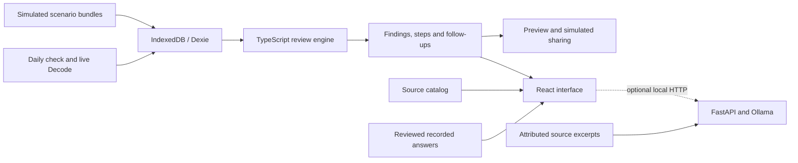

# Architecture

Vitalents is a browser application with a deterministic review engine, local storage and an optional source-based assistant. Python tools generate simulated examples and check the data contract. The browser does not need a Python server for its core workflow.

## Application

| Location | Responsibility |
|---|---|
| [`app/src/features/`](../app/src/features/) | Body map, daily check, Decode, record, follow-ups, schedule, library, sharing and research views |
| [`app/src/engine/`](../app/src/engine/) | Reference comparison, Decode scoring and validity, rules, trends and schedule calculations |
| [`app/src/store/`](../app/src/store/) | Dexie persistence, Zustand state, record permissions and review recomputation |
| [`app/src/sync/`](../app/src/sync/) | Local delivery-state simulation and role-scoped sharing |
| [`app/src/pwa/`](../app/src/pwa/) | Offline support and explicit update prompt |
| [`content/`](../content/) | Domain content, demonstration rules, labels and source catalogs |
| [`contracts/`](../contracts/) | JSON Schemas, example bundle and shared numerical vectors |

The UI uses React 19, TypeScript, React Router and Recharts. Current dependency versions are recorded in the [lockfile](../app/package-lock.json). The app loads five scenario fixtures. A real played round may be added to a simulated history only with its live origin label preserved. New observations produce linked review records; information quality, follow-up and sync state remain separate.

## Calculation boundaries

The app's D-10 reference policy is checked against [`science/contract_logic.py`](../science/contract_logic.py) and [`contracts/vectors/`](../contracts/vectors/). The independent [`science/reference.py`](../science/reference.py) estimator has additional context and comparability requirements and is not interchangeable with that app policy. [Integration notes](reference/INTEGRATION_NOTES.md) describe the distinction.

The four-case scientific replay and the five app scenarios serve different demonstrations. Do not replace app fixtures with replay output without checking their contracts and expected behavior. The [science guide](../science/README.md) documents generation; the [research model](../research/README.md) reports synthetic comparisons with a personal-median baseline. Research output does not control app actions.

## Assistant and deployment

The [assistant](../ai/README.md) exposes `/ask`, `/consult` and `/health` through FastAPI. Ollama provides local inference and embeddings. Source retrieval, citation and number checks constrain output but do not establish scientific accuracy.

Cloudflare builds force `cached` mode in [`vite.config.ts`](../app/vite.config.ts). Published fallback answers are derived from immutable raw recordings and an entry-hash review policy. Local builds can optionally use `auto` or `live`; the assistant is never required for core functions.

The production build is static. A service worker precaches the shell and selected assets after initial loading; first access still requires connectivity. Role switching and delayed delivery are local demonstrations, not authenticated accounts or communication with a medical team. See [validation and limitations](validation.md).
